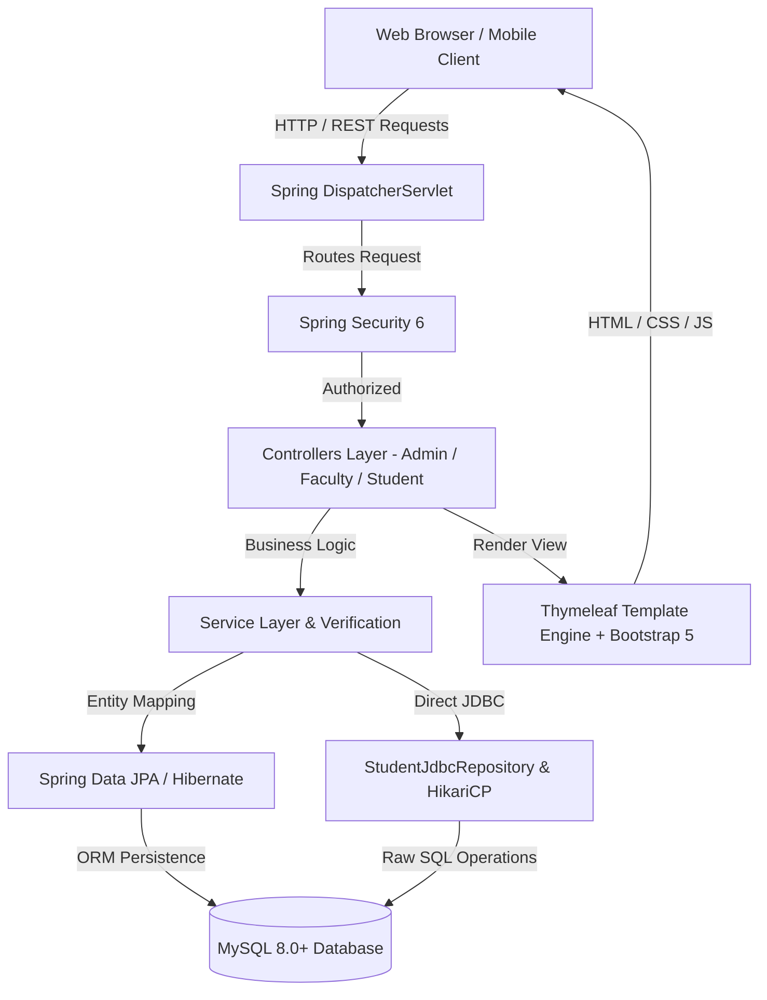
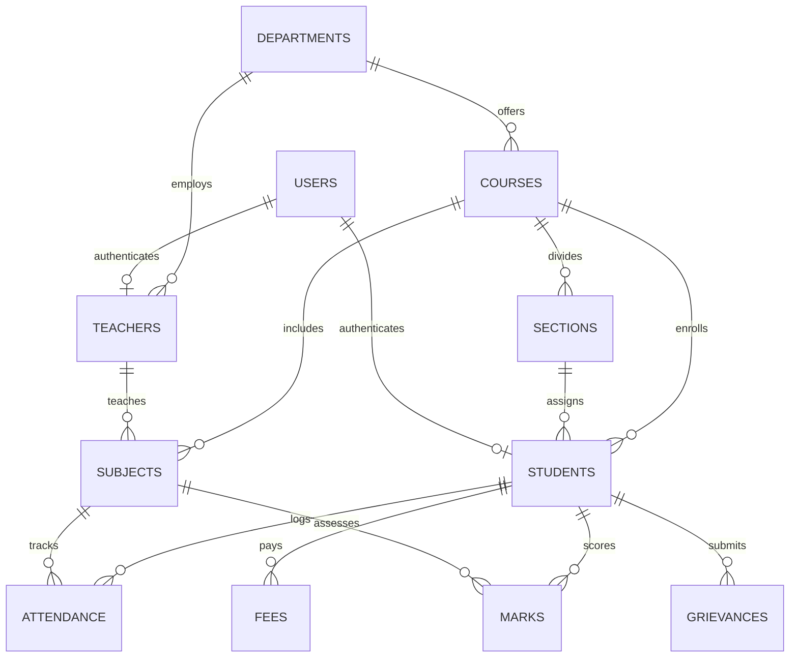

# 🎓 Student Management & University ERP System

[](https://openjdk.org/)
[](https://spring.io/projects/spring-boot)
[](https://www.mysql.com/)
[](https://getbootstrap.com/)
[](#)

---

## 📌 Project Overview

The **Student Management & University ERP System** is a full-featured, enterprise-grade web application built to streamline academic administration. Designed for colleges and universities, the system provides multi-role role-based portals for **Administrators**, **Faculty Members**, and **Students**.

It integrates end-to-end institutional workflows including student onboarding, QR-code attendance tracking, dynamic class timetabling, continuous evaluation and marksheets, digital fee payment receipts, syllabus and study materials, and student grievance handling.

---

## 🌟 Key Features

### 🛡️ 1. Administrator Portal
* **Live Analytics Dashboard**: Real-time counters for students, faculty, departments, courses, and pending grievances.
* **Student & Faculty Management**: Complete CRUD operations, profile management, and account status control.
* **Academics & Department Configuration**: Manage courses, departments, subjects, and section assignments.
* **Master Timetable Scheduling**: Interactive weekly timetable matrix organized by course, semester, and section.
* **Fee Record & Invoicing**: Track fee receipts, payment modes, and download server-generated PDF receipts.
* **Audit Logging & Security**: Track administrative actions and system security events.

### 👨‍🏫 2. Faculty Portal
* **QR Attendance Generation**: Generate dynamic QR sessions for real-time classroom attendance.
* **Manual & Bulk Attendance**: Period-wise and subject-wise attendance marking with percentage calculations.
* **Marks & Grading Management**: Enter internal marks, mid-terms, and final exam scores with auto-calculated grades and GPA.
* **Assignments & Submissions**: Post assignments with deadlines and evaluate student submissions.
* **Digital Study Materials**: Upload course lecture notes, syllabus files, and reference materials.

### 🎓 3. Student Portal
* **Personalized Dashboard**: Real-time attendance percentage alerts (with low-attendance warnings), CGPA, and enrolled subjects.
* **QR Attendance Scanner**: Scan live QR codes generated by faculty to record classroom presence instantly.
* **Grades & Marks Sheet**: View semester-wise grades and download digitally verifiable marksheet PDFs.
* **Digital ID Card**: Generate and download university student ID cards with embedded student QR verification code.
* **Fee History & Receipts**: View paid/pending balances and download PDF payment receipts.
* **Grievance Redressal**: Lodge academic or administrative grievances and monitor resolution status in real-time.

---

## 🏛️ System Architecture

The application is structured following the **Model-View-Controller (MVC)** architectural design pattern:



---

## 🗄️ Database Design (Relational Schema)

The database schema consists of **28 normalized relational entities**:



### Core Entities:
1. **`users`**: Authentication credentials, roles (`ROLE_ADMIN`, `ROLE_FACULTY`, `ROLE_STUDENT`), and activation status.
2. **`departments`**: Academic units (CS, IT, ECE, ME).
3. **`courses`**: Degree programs (B.Tech CSE, BCA, etc.) with credit hours and duration.
4. **`sections`**: Academic divisions (Section A, Section B) by semester.
5. **`teachers`**: Faculty profile, designation, qualification, and subject specialization.
6. **`students`**: Student demographics, enrollment number, semester, account status.
7. **`attendance`**: Daily and period-wise presence records with session IDs.
8. **`marks`**: Continuous assessment scores, grade points, and exam types.
9. **`fees`**: Tuition fee records, transaction reference, amount paid, and receipts.
10. **`timetable_entries`**: Day-of-week, period timings, room allocation, and assigned faculty.
11. **`grievances`**: Student complaints, category, priority, and resolution remarks.

---

## 💻 Tech Stack & Dependencies

| Layer | Technology | Details |
| :--- | :--- | :--- |
| **Language** | Java 17 (LTS) | OOP, Generics, Collections, Streams, Exceptions |
| **Backend Framework** | Spring Boot 3.3.4 | Spring Web MVC, Spring Security 6, Spring Data JPA |
| **Database** | MySQL 8.0+ / H2 (Fallback) | InnoDB engine, normalized tables, Foreign Key constraints |
| **Connection Pooling & JDBC** | HikariCP + MySQL Connector/J | Direct JDBC operations + JPA/Hibernate ORM |
| **Frontend / Templates** | Thymeleaf + HTML5 + CSS3 | Server-side rendering with reusable fragments |
| **UI Framework** | Bootstrap 5.3.3 + Bootstrap Icons | Fully responsive layout across desktop, tablet, and mobile |
| **Reporting & Export** | OpenPDF (LibrePDF 1.3.40) | Programmatic server-side PDF generation |
| **Barcode / QR Engine** | ZXing 3.5.3 | Dynamic QR code generation for attendance and ID cards |
| **Build Tool** | Apache Maven 3.9+ | Dependency management and build packaging |

---

## 🚀 Setup & Execution Guide

### 1. Prerequisites
Ensure you have the following installed on your machine:
* **Java Development Kit (JDK) 17** or higher:
  ```bash
  java -version
  ```
* **MySQL Server 8.0+** running locally (or test using in-memory H2 profile).
* **Git** installed on your system.

---

### 2. Database Configuration
1. Open MySQL Workbench or your MySQL CLI:
   ```sql
   CREATE DATABASE university2_0_erp;
   ```
2. Open `src/main/resources/application.properties` and verify your MySQL credentials:
   ```properties
   spring.datasource.url=jdbc:mysql://localhost:3306/university2_0_erp?createDatabaseIfNotExist=true&useSSL=false&allowPublicKeyRetrieval=true&serverTimezone=UTC
   spring.datasource.username=root
   spring.datasource.password=YOUR_MYSQL_PASSWORD
   ```
   *(Note: If no password is set on your local MySQL `root`, leave the password field empty).*

---

### 3. Run the Project

#### Option A: Run via Maven Wrapper (Recommended)
```bash
# On Windows PowerShell / Command Prompt:
.\mvnw.cmd spring-boot:run
```

#### Option B: Run via Standard Maven
```bash
mvn clean spring-boot:run
```

Once started, access the application in your browser:
🔗 **[http://localhost:8080](http://localhost:8080)**

---

## 🔑 Default Login Credentials

The application automatically seeds an initial database with ready-to-test accounts upon first launch:

| Role | Username / Email | Password | Access Portal |
| :--- | :--- | :--- | :--- |
| **Administrator** | `admin` | `Admin@123` | `/admin/dashboard` |
| **Faculty Member** | `david.miller@college.edu` | `Faculty@123` | `/faculty/dashboard` |
| **Student** | `alex.morgan@student.edu` | `Student@123` | `/student/dashboard` |

---

## 🧪 Live JDBC Connectivity Verification Endpoint

To verify direct JDBC connectivity as per academic review rubrics:
* **JDBC Diagnostics Status**: `http://localhost:8080/api/diagnostics/jdbc/status`
* **Direct JDBC Query Test**: `http://localhost:8080/api/diagnostics/jdbc/students`

---

## 📂 Project Directory Structure

```text
project-student-system/
├── src/
│   ├── main/
│   │   ├── java/com/example/studentmanagement/
│   │   │   ├── config/              # Security, JDBC Connection, Data Initializer
│   │   │   ├── controller/          # MVC Controllers (Admin, Faculty, Student, Diagnostics)
│   │   │   ├── dto/                 # Data Transfer Objects & form models
│   │   │   ├── entity/              # 28 JPA / Hibernate Relational Entities
│   │   │   ├── exception/           # Global Exception Handler & Custom Exceptions
│   │   │   ├── repository/          # Spring Data Repositories & JDBC DAOs
│   │   │   └── service/             # Business Logic & PDF/QR Generators
│   │   └── resources/
│   │       ├── static/              # CSS (style.css), JS, Images, Avatars
│   │       ├── templates/           # Thymeleaf templates (admin/, faculty/, student/, layout/)
│   │       └── application.properties # Configuration file
├── pom.xml                          # Maven build dependencies
├── .gitignore                       # Ignored files for clean repository
├── README.md                        # Documentation
└── presentation_slides.html         # Interactive Presentation Slides
```

---

## 👥 Contributors & Academic Review
* **Project**: Student Management System (Enterprise University ERP)
* **Domain**: Java Web Application Development
* **Evaluation**: Academic Project Review 1
